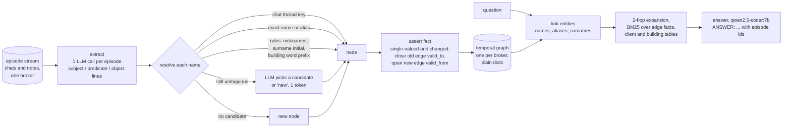

# An incrementally growing knowledge graph against batch GraphRAG and hybrid search, measured

A real-estate broker's knowledge is a stream, not a corpus. Every WhatsApp message and every note adds something, and much of it replaces something older: a client raises the budget, drops one building for another, needs a third bedroom; a developer changes the starting price or delays the keys. Retrieval over the raw messages returns the old budget next to the new one. A GraphRAG index built in batch knows who is who, but it is a function of the whole corpus: every new message means building it again, and it has no notion of a fact that stopped being true. This project tests a third design, the one behind the idea of "an Obsidian-style knowledge graph for each broker, growing with every conversation": each new message is read once, its entities are matched to the nodes the graph already has, and a fact that changed gets an end date instead of being overwritten. The question is whether that graph answers better than plain hybrid search, at a per-message cost far below rebuilding, and where it loses.

Everything runs locally: Python standard library plus numpy and requests, and a local Ollama server with one 7B model. The brokerage, its brokers, clients, buildings and city are synthetic and fictional (**Velmora**, an invented city).

**Headline: a held-out test of question understanding.** The structured questions (lists, counts, highest and lowest, "the building X is focused on", "who can afford what") are best answered by code over the graph, not by a 7B model reading facts. The question is whether a question typed by a broker is understood. On a held-out set written and committed before the parser existed (58 questions with abbreviations, slang, typos, other word orders, relative dates, 21 of them in Portuguese; 46 that should become a query and 12 that should not), a closed form filled by one short model call and then validated and run by code answered **81.0% [70.7, 91.4]** correctly in the blind measurement, against **39.7% [27.6, 51.7]** for the seven fixed patterns of the third run (+41.4 points, paired bootstrap [+25.9, +56.9]) and 32.8% for hybrid search. The fixed patterns matched none of the 46 held-out questions. The form matched the hand-written gold form exactly for 80.4% of the 46, fell back to retrieval once, and never fired on the 12 that should not become a query. Portuguese and English scored the same (81.0% and 81.1%). It was wrong but confident 8 times: a valid form that was not the gold form, and a wrong answer. Reading those failures found a bug in my executor (the field `interested_in.name` was accepted and matched nothing); after fixing it, the same model outputs, replayed, give 86.2% [77.6, 94.8] and 4 wrong-but-confident answers, but that number is no longer blind. On the original 81 questions the parser is **not** free: two lookups ("which neighborhood does William Thorne want to live in?") were read as the neighborhood of the client's building, and the parser scores 92.6% against 95.1% for the patterns (-2.5 points [-6.2, 0.0]; before the fix, 86.4%, -8.6 [-14.8, -3.7]).

**Earlier runs, in one paragraph.** In the reference run, on 81 gold questions over a 130-episode stream, the incremental temporal graph answered 74.1% correctly against 61.7% for hybrid search (+12.3 points, paired bootstrap 95% CI [+2.5, +22.2]) and 60.5% for batch GraphRAG, but it lost on "now" questions: 7 of the 21 answers whose slot had changed stated the old value (33.3%, against 4.8% for hybrid), although the graph held the right current value every time, and multi-hop questions were bad for all three systems (0 to 2 of 12). A second run changed only the incremental graph's answering side, with two fixes: the context lists current facts first and superseded values in a separate history section, and the four multi-hop question forms of this gold set are answered by a deterministic query over the graph. It reached 87.7% [80.2, 93.8] (+25.9 points over hybrid [+16.0, +37.0]), with 0 stale answers and 0 wrong-period answers, but almost all of the gain over the first run is the multi-hop query (12 of 12), which was written for exactly those question forms; on the other 69 questions the second run is +1.4 points [-7.2, +11.6] over the first, because the new layout fixed 6 temporal and "as of" answers and lost 3 aggregation counts and 2 "as of" prices. A third run moved the aggregation questions (counts and the highest budget) to code as well: aggregation went from 3 of 9 to 9 of 9, nothing else changed, and overall accuracy reached 95.1% [90.1, 98.8] (+33.3 points over hybrid [+22.2, +44.4], +7.4 over the second run [+2.5, +13.6]). The 21 multi-hop and aggregation questions are now answered by code that recognizes this generator's wording, so they say what the graph holds, not how a real question would be understood; on the other 60 questions, answered by retrieval and the model alone, the graph scores 93.3% against 81.7% for hybrid (+11.7 [+1.7, +21.7]). Entity resolution is where the graph is clearly better as a structure: 0 wrong merges, 2.6% duplicate nodes against 36.4% for the batch graph's name-only merging, all 33 superseded facts closed on the exact date. Isolation held: 0 leaks in 9 probes for every per-broker system, against 8 of 9 for one shared index. Absorbing the last 32 episodes cost the incremental graph 34 LLM calls and 71 s of model time (2.2 s per episode) against 146 calls and 1,106 s to rebuild the batch graph (389 s with cached extractions); re-indexing hybrid search cost no LLM call. Reference run: 43 minutes uncached on an Apple M5 laptop with 16 GB of RAM, on an Ollama server shared with a production system; second run: 81 new answer calls, 5 minutes; third run: 9 new answer calls, 21 seconds.

## Architecture



The two comparison systems read the same stream. **Batch GraphRAG** makes the same extraction call per episode, then merges entities by normalized name, keeps every fact with the dates it was stated, finds communities (Louvain) and writes one LLM report per community; it is rebuilt when new episodes arrive. **Hybrid search** indexes the raw episodes with BM25 and LSA fused by Reciprocal Rank Fusion. All three answer with the same prompt and the same model; only the context block differs.

## Design decisions, and why

**A stream built around the failure modes** (`incgraph/synth.py`, `incgraph/questions.py`). Three brokers, seven clients each, eight buildings in a shared catalogue (developer, neighborhood, metro station, bedroom counts, starting price, delivery month). Each broker's stream runs from January to June 2026: listing notes, client chats (the client writes in the first person; the chat header names the contact as saved in the broker's phone), the broker's own notes, a few replies and office notes with no facts. 130 episodes, 293 true facts. Facts change on purpose: every broker has a client who raises the budget twice, one who switches buildings, one who needs another bedroom, one who moves the deadline, one who cuts the budget and switches, two buildings whose price changes and one whose delivery slips (33 superseded facts in all). Confounders on purpose: Marina Okafor (broker A) and Marina Lindqvist (broker B); Daniel Reyes and Daniel Weber at the same broker; chat contacts saved as "Kate Moreau", "Fil Arantes", "Dani Reyes", "Jonah P" for clients whose own messages and the broker's notes give the full names Katherine Moreau, Felipe Arantes, Daniel Reyes and Jonah Pellegrini; buildings written as "N1", "the Lofts", "Aurora Res.", "the Gardens", and two buildings sharing a word, so "the Aurora" is ambiguous without context. The generator keeps the ground truth: every entity with every surface form used for it, every fact with its validity interval and the episode that stated it, and per episode which entity each surface form refers to. Output is byte-identical for a seed.

The 81 gold questions (27 per broker) are typed: 15 single-hop (developer, station, wanted neighborhood, buildings visited, an objection), 15 temporal "now" (budget, building of interest, bedrooms, price, delivery after they changed), 12 "as of" a past date, 12 multi-hop (the developer of the building a client is focused on now; which clients are interested in a building near a station; the owner's example, "which of my clients looking for 3 bedrooms can afford a building delivered in 2027 near Riverside station?"), 9 aggregation (counts and the highest budget, over current values), 9 unanswerable near misses (a building that does not exist, a real building this broker never listed, an attribute nobody stated) and 9 isolation probes (broker A asked for the budget of broker B's client, the Marina pair first). Gold answers are atoms derived from the ground truth (an amount, a month, a count, entities, a keyword), plus the values the same slot held at other times (for the stale-fact rate) and, for isolation probes, the other broker's values (for leaks).

**One extraction call per episode, written as lines** (`incgraph/extract.py`). A fixed schema of 13 predicates over 5 entity types, four short examples with invented names, up to two earlier messages of the same chat as context, and one `subject | predicate | object` line per fact. The first version asked for JSON and the model pretty-printed it: about 200 output tokens for a listing note, at the 8.7 tokens per second this shared 7B server produced, 20 to 40 s per episode. The same facts as lines cost about 40 to 100 tokens. Both graph systems use exactly this call, so they start from identical extractions and the comparison isolates what happens after extraction: entity resolution, time, communities, and update cost.

**Entity resolution: deterministic first, the LLM only when ambiguous** (`incgraph/resolve.py`). In order: (1) the chat thread, because a WhatsApp thread is a phone number, the strongest key a broker has; (2) exact normalized name or alias of the same type; (3) rules: compatible first names (equal, a small table of common English nicknames, or a 3-letter prefix) with the same surname or a surname initial, building names whose every word starts a word of the candidate, places by their words; (4) the LLM, when the rules leave more than one candidate or only a weak one (a bare first name, the same surname with a first name the table does not know): it sees the message, the chat context and what the graph knows about each candidate, and answers with one digit, read from the log-probabilities; 0 means "new". A surface form becomes an alias only if it pointed to one candidate, so "the Aurora" is never learned as a name. The nickname table has generic English nicknames only ("Kate", "Dani", "Liz"), not the Portuguese ones in the data ("Fil", "Bia"), so those reach the LLM or the thread key.

**Facts get an end date instead of being overwritten** (`incgraph/graph.py`). Edges carry `valid_from`, `valid_to`, `invalidated_by` and every episode id that stated them. A new value for a single-valued predicate (budget, bedrooms, wanted neighborhood, deadline, building of interest, developer, location, station, price, delivery) closes the open edge at the new episode's date; multi-valued ones (visits, objections, bedroom counts a building offers) accumulate. Restating a value adds the episode to the edge and changes nothing else. The graph is a few dicts; there is one per broker and no structure is shared, so a question to one broker's graph cannot reach another's data. That isolation is by construction, and it is the reason the isolation probes can only fail by confusing two of the broker's own entities.

**Retrieval over the graph** (`incgraph/retrieve.py`). Link the entities the question names (full names and aliases, a client's surname; a first name followed by a different capitalized surname does not link, so "Marina Lindqvist" does not pull in Marina Okafor); take every fact touching them and the 25 facts touching their neighbours that best match the question by BM25 (2 hops); when nothing links, BM25 over all fact lines as a net. Questions about "my clients" or "how many" also get one row per client and per building, because lists and counts need all of them, not the top k: current values in the incremental graph, every value with the date it was first stated in the batch graph. Each fact line says whether it is current or superseded and when, and carries its episode ids for citation.

**Second run: context layout and a deterministic multi-hop query** (`incgraph/retrieve.py`, `incgraph/query.py`). After the reference run showed the model reading superseded lines first, the incremental graph's context was changed: current facts come first, superseded values move to a separate "History (superseded values)" section (kept, because "as of" questions need it), and every line puts its validity label before the value (`[a-044] current since 2026-05-20: Aurora Residences | price | $680,000`; `[a-001] superseded, held 2026-01-05 to 2026-05-20: ...`). Separately, a question matching one of the four multi-hop forms of this gold set (the developer or the station of the building a client is focused on now; the clients interested in a building near a station; the clients wanting N bedrooms who can afford a building near a station delivered in a year) is answered by code over the graph's current edges, and the model receives the result and the facts that prove it, only to phrase it. **This is not a natural-language query parser.** It is four regular expressions written against the question generator's own wording, so on these 12 questions it measures what the graph supports when the join is done by code, not how often a real broker's question would be recognized. Anything that does not match, or whose client or station cannot be linked to exactly one node, takes the ordinary retrieval path. Both changes apply to the incremental graph only; the batch graph and the hybrid baseline answer exactly as in the reference run.

**Third run: aggregation by code too** (`incgraph/query.py`). The second run showed the 7B model's counts moving with unrelated context changes, so counting and comparing went to code. The graph side is general: `value_at(node, predicate, date)` returns the edge that holds at a date (the open edge for "now", otherwise the one with `valid_from <= date < valid_to`), `count_where(type, predicate, test, date)` returns the nodes whose value passes a test, and `extreme(type, predicate, highest, date)` returns the nodes with the highest or lowest numeric value, ties included; each returns the edges that decided it, which go to the model as evidence. **The recognizer is not general.** Three regular expressions cover the generator's aggregation wording ("how many of my clients want N bedrooms right now?", "how many of my clients have a budget above $X right now?", "which of my clients has the highest budget right now?") with a little slack (want, need or are looking for; above, over, below or under; highest or lowest; "right now", "now" or "on <date>"). Any other phrasing ("how many buildings deliver in 2027?") takes the retrieval path. The context the model gets is one line of result ("Result: 4 (Daniel Reyes, Daniel Weber, Beatriz Lund, Elisabeth Grant)") and the edges behind it.

**Fourth run: a closed form filled by the model, checked by code** (`incgraph/form.py`, `incgraph/heldout.py`, `incgraph/formeval.py`). The seven patterns were replaced by one short model call that fills a closed form: an operation (join, count, max, min, or none), a target (client or building), filters (a field from a closed list, an operator, a value), optional "can afford" building conditions, a metric, a return field and a date. The model writes it as a few `key: value` lines (median 26 output tokens and 2.7 s per question, p90 4.7 s). Code then validates it: the operation, fields and operators must be in the closed lists; the operator must fit the field (names take = or !=, amounts comparisons, `year` only months); every value must normalize (amounts in English or Portuguese, such as "800k" or "800 mil", months, years, names that resolve to nodes of this broker's graph, a client name to exactly one client); max and min need a numeric metric; a return field is allowed only as `interested_in.<building field>` with join, so a lookup of one client's own field is not a form; the date must not be in the future. An invalid form, or "none", takes the ordinary retrieval path. A valid form runs on the graph's edges at its date, and the answer ends with a line stating what was understood ("UNDERSTOOD: counted clients with bedrooms = 3, budget <= $800,000, now"), so the broker can see how the question was read. The prompt has six examples with invented names, none from either question set; it was checked on four invented questions before the measurement and not changed afterwards.

**The held-out set came first** (`incgraph/heldout.py`, `data/heldout.jsonl`, commit `3291f33`). It was written and committed on its own before any parser code, and not edited afterwards. Each question has a hand-written gold form; gold answers come from running the gold form on the generator's true facts with an evaluator that shares no code with the graph executor. A month-level date ("back in March") is accepted only when the gold answer is the same on every day of that month. Run on the real graph built from the model's extractions, the 46 gold forms give the right answer 44 times: the other two need a fact the extractor missed (Teresa Vilar's interest in Saltmarsh Gardens), so 44 of 46 is the ceiling for any parser here.

**Batch GraphRAG, scaled down** (`incgraph/batch.py`). The indexing recipe of Microsoft's GraphRAG (Edge et al., 2024): extraction per text unit (here, the same per-episode call), entities merged by normalized name and type as GraphRAG merges by title, every distinct fact kept with the dates it was stated (a batch index has no notion of a fact ending), Louvain communities (GraphRAG uses Leiden; at about 40 nodes per broker the difference does not matter), and one LLM report of at most 4 sentences per community of 3 or more entities, told to give the most recent value when values conflict. Retrieval is the graph retrieval above plus the reports of the linked entities' communities. GraphRAG's global map-reduce search over all reports was not built; the client and building tables stand in for it on list and count questions.

**Hybrid baseline** (`incgraph/retrieve.py`, `bm25.py`, `fusion.py`, `text.py`). BM25 (k1 1.2, b 0.75), LSA (32 dimensions) and RRF (k 60) over one broker's episodes, top 8 to the answerer, listed oldest first with dates and the chat header so the model can tell a newer value from an older one. The BM25, LSA, RRF and tokenizer code comes from my hybrid-search-rag project (same author). LSA again stands in for a neural embedder: the local Ollama refuses `/api/embed`, and nothing could be installed. A second hybrid index over all three brokers' episodes answers only the isolation probes, to show what per-broker isolation prevents.

**One answer prompt** (`incgraph/answer.py`). The broker's name, today's date (2026-06-30), five rules (use only the context; a different surname is a different person; "now" means the latest value, a past date means the value that held then; lists and counts; cite episode ids) and a one-line reply, `ANSWER: <short answer> [episode ids]`. Fixed text first, context and question last, so consecutive calls share a prompt prefix.

**Scoring is deterministic** (`incgraph/scoring.py`, `incgraph/graphq.py`). An answer line is correct when it does not decline, contains every required atom (amounts in any of "$968,000", "968k", "968 thousand"; months as "June 2027", "Jun 2027", "2027-06"; counts as digits or words; entities by any unambiguous name) and, for lists, names no client or building that should not be there; questions with no answer are correct only when declined. Stale: wrong, and states a value the slot held at another time. Leak: an isolation probe whose answer states the other broker's value for that client. Graph quality maps every node to a true entity through the per-episode ground truth of which surface form means which entity, then counts wrong merges (a node holding mentions of two true entities), duplicates (extra nodes per true entity), relation precision and recall against every true fact including history, the share of true single-valued slots whose open values are exactly the true current value, and the share of superseded facts closed with the exact date. Paired bootstrap, 10,000 resamples, seed 42, as in hybrid-search-rag.

**The shared Ollama server.** The machine's Ollama also serves a production system that keeps `qwen2.5-coder:7b` loaded with `keep_alive -1` and `num_ctx 24576`. Every request sends `"keep_alive": -1` and the options `{"num_ctx": 24576, "temperature": 0, "seed": 42}` (plus `num_predict`), because another `num_ctx` would force a reload; calls are strictly sequential; a failed call waits 20 s, 60 s, then 180 s before giving up; and the code only ever POSTs to `/api/chat` (`/api/ps` is read before and after the run and recorded in `results/run_meta.json`). Every call goes through a sqlite3 cache keyed on the full request and is logged in a ledger (`results/llm_ledger.jsonl`) with its purpose, the episode or question it served, its token counts and the latency measured when it was really made, so cost tables are identical on a replay.
## Results

### Fourth run: the closed-form parser on the held-out set (58 questions, written before the parser)

`python3 -m incgraph form-eval` (commit of this README). Blind measurement: 318 new model calls (139 form calls, the rest answers), 865 s, `results/form_run4a/`. After the executor fix: the same form outputs replayed from the cache, 4 new answer calls, `results/form/`.

| | hybrid | third run: 7 fixed patterns | closed form, blind | closed form, after the executor fix |
|---|---|---|---|---|
| accuracy, all 58 (95% CI) | 32.8% [20.7, 44.8] | 39.7% [27.6, 51.7] | **81.0% [70.7, 91.4]** | 86.2% [77.6, 94.8] |
| the 46 that should become a query | 17.4% | 26.1% | **78.3%** | 84.8% |
| the 12 that should not | 91.7% | 91.7% | 91.7% | 91.7% |
| Portuguese (21) / English (37) | 33.3% / 32.4% | 38.1% / 40.5% | 81.0% / 81.1% | 85.7% / 86.5% |
| form matches the gold form exactly (46) | | the patterns matched 0 of 46 | 80.4% (Portuguese 81.2%) | 89.1% (Portuguese 87.5%) |
| fallback to retrieval (46) | | | 2.2% (1) | 2.2% (1) |
| false trigger on the 12 that should not | | | 0 | 0 |
| **wrong but confident** (valid form, not the gold form, wrong answer) | | | **8** of 45 forms that ran | **4** |

Paired bootstrap, blind: closed form against the patterns +41.4 points [+25.9, +56.9], against hybrid +48.3 [+34.5, +62.1]; on the 46 query questions alone +52.2 [+32.6, +69.6] against the patterns. The patterns against hybrid: +6.9 [-5.2, +19.0], inside noise, since the patterns never fired and both answered by retrieval.

What went wrong, read one by one (`results/form_run4a/heldout_answers.jsonl`):
- **Executor bug, 4 of the 8.** The model often wrote `interested_in.name = Mill House`, a field the schema lists and that means the same as `interested_in = Mill House`. The validator accepted it; the executor had no rule for a building's own name reached through `interested_in` and matched nothing, so the answer was "I don't know" or 0 (h21, h25, h40, h50). Fixed by treating `interested_in.name` as `interested_in`; with the fix, three of them become right and h25 matches the gold form but still counts 2 instead of 3, because of the fact the extractor missed.
- **Model errors, 4.** "Smallest" and "menor" read as max (h03, h51); "Harbor Central" taken as a neighborhood instead of a station (h04); a count instead of a list for "prédios entregues em 2027 perto da estação Harbor Central" (h33, which answered "1" for a list of one building). In every one of these the UNDERSTOOD line shows the misreading, which is the point of printing it.
- **One fallback.** "who develops amir's building now" came back as `op: none`.
- **One right form, wrong answer.** h23 had the gold form; the graph lacks the fact above.

### Fourth run on the original 81 questions (no regression may hide)

| | third run: 7 patterns | closed form, blind | closed form, after the fix |
|---|---|---|---|
| accuracy, all 81 (95% CI) | **95.1%** [90.1, 98.8] | 86.4% [79.0, 93.8] | 92.6% [86.4, 97.5] |
| against the third run (paired) | | **-8.6 [-14.8, -3.7]** | **-2.5 [-6.2, 0.0]** |
| against hybrid (paired) | +33.3 [+22.2, +44.4] | +24.7 [+11.1, +37.0] | +30.9 [+18.5, +43.2] |
| multi-hop (12) / aggregation (9) | 100% / 100% | 100% / 100% | 100% / 100% |
| single-hop (15) / temporal "now" (15) / as of (12) | 100% / 100% / 66.7% | 86.7% / 80.0% / 50.0% | 86.7% / 100% / 66.7% |
| false triggers on the 60 other questions | | 7 | 2 |

The parser fell back on none of the 21 structured questions and answered all of them right. **The regression is false triggers on lookups.** Blind: 7, all wrong answers; five were "which building is X interested in (now / on a date)?" turned into a form returning `interested_in.name` that, by the stated design, is a lookup and should have been rejected; the fix rejects it. The two that remain are genuine: "Which neighborhood does William Thorne want to live in?" (and the same for Elisabeth Grant) was read as "the neighborhood of the building they are interested in", a valid form with a different meaning, and answered confidently and wrong. The patterns could not make that mistake because they could not read the question at all; the parser can, and on this set that costs 2 answers in 81.

The reference run is one uncached `python3 -m incgraph run` at commit `d8b60b1` (2,555 s wall time, 402 uncached LLM calls, 2,539 s of model time): 718 s of extraction, 389 s of community reports, 5 s of merge decisions and 1,428 s of answers. Its artifacts are under `results/archive/run1_reference/`, and at that commit `python3 -m incgraph eval` replays it from the cache in 2 s, byte for byte. The second run (commit `a8b9a85`, artifacts in `results/archive/run2_layout_multihop/`) used the same cache: every extraction, merge decision, community report and every hybrid and batch answer replayed (the prompts are identical), and only the 81 incremental-graph answers were new (316 s). The third run is `python3 -m incgraph run` at the current commit, again from the same cache: only the 9 incremental-graph aggregation answers were new (21 s; `results/run_meta.json`), every other answer of every system is byte-identical to the second run, and `eval` replays it byte for byte. Its artifacts are under `results/`: `report.md` has every table, `answers.jsonl` every context size, answer and score, `graphs/` both graphs of every broker, `resolution_log.jsonl` every resolution decision with its route, `extractions.jsonl` every raw extraction, and `llm_ledger.jsonl` every call. Model: `qwen2.5-coder:7b` (Q4_K_M) through Ollama 0.40.10, temperature 0, seed 42.

### The three runs of the incremental graph (the other systems are unchanged in all three)

| | reference run | second run: layout + multi-hop query | third run: + aggregation by code |
|---|---|---|---|
| accuracy, all 81 (95% CI) | 74.1% [64.2, 82.7] | 87.7% [80.2, 93.8] | **95.1% [90.1, 98.8]** |
| accuracy, the 69 questions that are not multi-hop | 84.1% [75.4, 92.8] | 85.5% [76.8, 92.8] | 94.2% |
| accuracy, the 60 questions answered by retrieval (neither query) | 86.7% [78.3, 95.0] | 93.3% [86.7, 98.3] | 93.3% [86.7, 98.3] |
| stale, "now" (21 questions whose slot changed) | 33.3% | **0.0%** | **0.0%** |
| wrong period, "as of" (12) | 25.0% | **0.0%** | **0.0%** |
| single-hop (15) | 100% | 100% | 100% |
| temporal "now" (15) | 86.7% | **100%** | **100%** |
| as of (12) | 50.0% | 66.7% | 66.7% |
| multi-hop (12) | 16.7% | **100%** (deterministic query) | **100%** (deterministic query) |
| aggregation (9) | 66.7% | 33.3% | **100%** (deterministic query) |
| unanswerable declined (9) / isolation declined (9) / leaks | 100% / 100% / 0 | 100% / 100% / 0 | 100% / 100% / 0 |
| false "I don't know" on answerable questions | 4.8% | 6.3% | 6.3% |
| correct answers citing a gold episode | 100% | 98.1% | 98.3% |
| median prompt tokens | 1,266 | 1,140 | 905 |

For comparison, hybrid search scores 61.7% on all 81 and 81.7% [71.7, 91.7] on the 60 retrieval questions; batch GraphRAG 60.5% on all 81.

Third run, paired bootstrap (95% CI, 10,000 resamples): against hybrid **+33.3 points [+22.2, +44.4]**; against batch GraphRAG +34.6 [+23.5, +45.7]; against the second run +7.4 [+2.5, +13.6]; against the reference run +21.0 [+11.1, +30.9]. By type against hybrid: single-hop +13.3 [0.0, +33.3], temporal "now" +6.7 [0.0, +20.0], as of +33.3 [-8.3, +75.0], multi-hop +91.7 [+75.0, +100], aggregation +100 [+100, +100], unanswerable and isolation +0.0 (both 100%). On the 60 questions neither query touches: +11.7 [+1.7, +21.7] against hybrid, and +6.7 [-1.7, +16.7] against the reference run (the layout fix, inside noise).

Third run, answer by answer against the second run: **6 fixed, 0 broken**, every other answer of every system unchanged. Fixed: five counts that had come out short, four of them by one and one by two ("How many of my clients have a budget above $800,000 right now?": 2 became 4), and "Which of my clients has the highest budget right now?" for broker C (Elisabeth Grant became Daniel Reyes, whose budget had been raised twice). The other three aggregation answers were already right and kept the same text.

Second run against the reference run:

Paired bootstrap, incremental graph against hybrid search: reference run +12.3 points [+2.5, +22.2], second run **+25.9 [+16.0, +37.0]**; without the 12 multi-hop questions, +13.0 [+1.4, +24.6] and +14.5 [+4.3, +24.6]. Second run against the reference run: +13.6 [+3.7, +24.7] on all 81, +1.4 [-7.2, +11.6] without multi-hop. Against batch GraphRAG: +27.2 [+14.8, +39.5]. By type against hybrid in the second run: temporal "now" +6.7 [0.0, +20.0], as of +33.3 [-8.3, +75.0], multi-hop +91.7 [+75.0, +100], aggregation +33.3 [+11.1, +66.7].

What changed in the second run, answer by answer (`results/archive/run2_layout_multihop/answers.jsonl` against `results/archive/run1_reference/answers.jsonl`):
- **Fixed by the layout (6):** both stale building prices ("What is the current starting price at Aurora Residences?" now $680,000, not $640,000), and four "as of" answers, three of them "budget on a date" questions that had been answered with another period's budget, and one that had been "I don't know".
- **Fixed by the query (10):** every multi-hop question the reference run got wrong, including all five stale "developer / station of the building X is focused on now" answers and the owner's example in all three brokers.
- **Worse (5).** Three aggregation counts dropped by one ("How many of my clients want 3 bedrooms right now?": the answer cites the five right episodes and says 4). The client and building tables these questions read are byte-identical in both runs; only the fact lines around them changed, and the 7B model's counting moved with them. Two "as of" price questions ("What was the starting price at Aurora Park on February 26, 2026?") went from correct to "I don't know", now that the old price sits in the history section. **Aggregation was the one number that got worse in the second run, from 66.7% to 33.3%;** the third run took it to 9 of 9 by moving it to code.

### Reference run: answers (81 questions, 27 per broker)

| system | accuracy (95% CI) | answerable (63) | false "I don't know" | stale, "now" (21) | wrong period, "as of" (12) | unanswerable declined (9) | isolation leaks (9 probes) | correct answers citing a gold episode | median prompt tokens |
|---|---|---|---|---|---|---|---|---|---|
| Hybrid (BM25 + LSA + RRF over episodes) | 61.7% [50.6, 71.6] | 50.8% | 6.3% | **4.8%** | 25.0% | 100% | 0 | 96.9% | 714 |
| Batch GraphRAG | 60.5% [49.4, 71.6] | 49.2% | 15.9% | 33.3% | **8.3%** | 100% | 0 | 100% | 1,260 |
| Incremental temporal graph | **74.1%** [64.2, 82.7] | **66.7%** | **4.8%** | 33.3% | 25.0% | 100% | 0 | 100% | 1,266 |
| *one hybrid index shared by all brokers (isolation probes only)* | | | | | | | **8** | | |

"Stale, now" is over the 21 questions whose answer slot changed over time (15 temporal "now" questions and 6 multi-hop "now" questions): wrong, and stating a value the slot held earlier. "Wrong period" is the same for "as of" questions. Every isolation probe was declined by all three per-broker systems.

By question type:

| system | single-hop (15) | temporal "now" (15) | as of (12) | multi-hop (12) | aggregation (9) | unanswerable (9) | isolation (9) |
|---|---|---|---|---|---|---|---|
| Hybrid | 86.7% | **93.3%** | 33.3% | 8.3% | 0.0% | 100% | 100% |
| Batch GraphRAG | 93.3% | 66.7% | 25.0% | 0.0% | 44.4% | 100% | 100% |
| Incremental temporal graph | **100%** | 86.7% | **50.0%** | **16.7%** | **66.7%** | 100% | 100% |

Paired bootstrap on accuracy, points (95% CI, 10,000 resamples over the same questions):

| comparison | all 81 | single-hop | temporal "now" | as of | multi-hop | aggregation |
|---|---|---|---|---|---|---|
| incremental vs hybrid | **+12.3 [+2.5, +22.2]** | +13.3 [0.0, +33.3] | -6.7 [-26.7, +13.3] | +16.7 [-25.0, +50.0] | +8.3 [0.0, +25.0] | **+66.7 [+33.3, +100]** |
| incremental vs batch | **+13.6 [+4.9, +22.2]** | +6.7 [0.0, +20.0] | +20.0 [-13.3, +53.3] | +25.0 [0.0, +50.0] | +16.7 [0.0, +41.7] | +22.2 [0.0, +55.6] |
| batch vs hybrid | -1.2 [-9.9, +8.6] | +6.7 [0.0, +20.0] | **-26.7 [-53.3, -6.7]** | -8.3 [-41.7, +25.0] | -8.3 [-25.0, 0.0] | **+44.4 [+11.1, +77.8]** |

### Graph quality against the ground truth (3 brokers pooled; the same graphs in both runs)

| graph | nodes | wrong merges | duplication rate | clients: nodes / true | buildings: nodes / true | relation precision | relation recall | current-value accuracy (195 slots) | superseded facts closed, exact date (33) |
|---|---|---|---|---|---|---|---|---|---|
| Incremental temporal graph | 80 | 0 | 2.6% | 21 / 21 | 20 / 18 | 96.6% | 98.6% | **97.9%** | **33 (33)** |
| Incremental, no LLM merges (ablation) | 79 | 0 | 1.3% | 21 / 21 | 19 / 18 | 96.6% | 98.6% | 97.9% | 33 (33) |
| Batch GraphRAG | 106 | 0 | 36.4% | 39 / 21 | 28 / 18 | 96.6% | 98.6% | 81.5% | 0 |

Relation precision and recall are identical by construction: both graphs come from the same extractions, and the metric maps every node to its true entity before comparing triples, so it measures the extractor, not the merging. The extractor's own errors account for the 3.4% of wrong relations (a listing note whose price and delivery were dropped, "I liked what I saw about X" read as a visit, "Forget Quarry Lofts" turned into a visit and an objection). Current-value accuracy is the share of true single-valued slots whose open values are exactly the true current value; the batch graph keeps 32 slots with two or more conflicting values. Resolution routes in the incremental graph: 38 by chat thread (plus 21 new threads), 119 exact, 10 by rule, 58 new entities, 4 by the LLM.

### Cost of absorbing new episodes (the last quarter of each stream: 32 of 130 episodes)

| strategy | LLM calls | tokens (prompt + output) | LLM seconds | LLM seconds per new episode |
|---|---|---|---|---|
| incremental: fold each new episode in | 34 (32 extractions, 2 merges) | 21,313 | 71 | **2.2** |
| batch: rebuild from scratch | 146 (130 extractions, 16 reports) | 101,826 | 1,106 | 34.6 |
| batch: rebuild, extractions replayed from a cache | 16 (reports only) | 12,558 | 389 | 12.1 |
| hybrid: re-index BM25 and LSA | 0 | 0 | 0 (0.2 s of numpy) | 0 |

The batch rows assume one rebuild for the whole batch of 32. A batch graph as fresh as the incremental one, rebuilt after every episode, would pay a full rebuild each time: 1,106 s per episode, or 389 s with an extraction cache, because community reports depend on the whole graph. One extraction call: median 4.2 s, 657 prompt and 29 output tokens on average; one community report: 24 s for about 109 output tokens. Merge decisions are 1 output token (1.0 to 1.5 s). The incremental graph's deterministic work is under 0.1 s per broker for the 32 episodes. (`results/report.md` shows 2.6 s of "python seconds" for it, because the two merge calls ran inside the resolution step's timer; they are also counted in its LLM columns.)

### Read plainly

- **The incremental graph wins overall, and the margin is not noise** (reference run: +12.3 points against hybrid, +13.6 against batch, both intervals above zero; second run: +25.9 and +27.2, mostly the multi-hop query; third run: +33.3 and +34.6, the rest being aggregation by code). On the 60 questions that neither query touches, the third run's graph is +11.7 points over hybrid [+1.7, +21.7]: smaller, and the number to quote for the graph with retrieval and a 7B model alone. In the reference run most of it is aggregation: counting clients who want 2 bedrooms or have a budget above a threshold, and finding the highest budget, needs every client's current value, which the graph's client table gives in one place and eight retrieved messages never do (hybrid 0 of 9). It also answered all 15 single-hop questions.
- **It does not beat hybrid on "now" questions, and its stale-fact rate is the worst result in this repository.** 7 of the 21 answers whose slot had changed stated the old value, against 1 for hybrid. Five of them are multi-hop ("who develops the building Marina Okafor is interested in now?"), two are building prices. In every one checked the graph was right: the superseded edge was closed and marked "superseded: held from ... to ...", the current one marked "current", and the 7B model still took the line listed first. The hybrid context lists messages oldest first, so the newest value is the last thing the model reads, and that ordering helps a small model more than a "current" label does. The graph stores time correctly; its context does not yet make the right reading easy enough for a 7B answerer. The second run tested exactly that: with current facts first and history in its own section, the stale rate went from 33.3% to 0 and temporal "now" accuracy from 86.7% to 100%, and the wrong-period rate on "as of" from 25.0% to 0. The cost was three aggregation counts and two "as of" prices (above). So the time model was right from the start; what a 7B answerer gets right depends heavily on how the context is laid out, and a layout change moves several question types at once, not only the one it was aimed at.
- **Batch GraphRAG is hurt by what it lacks, not by extraction.** It has the same facts but no notion of their end: temporal "now" accuracy drops 26.7 points below hybrid (interval excludes zero), and its client table shows "Kate Moreau" and "Katherine Moreau" as two clients with two budgets. Its community reports did not rescue it. Its low wrong-period rate on "as of" questions (8.3%) is not an advantage: it declined 7 of those 12 questions and answered 3 correctly, against 6 correct for the incremental graph.
- **Multi-hop is weak everywhere** (1, 0 and 2 of 12). The owner's example ("which of my clients looking for 3 bedrooms can afford a building delivered in 2027 near Riverside station?") was answered correctly once in 9 tries across the three systems, by the incremental graph. All the facts it needs were in the incremental context (client table, building table); the join across bedrooms, budget, price, delivery year and station is beyond what this model does reliably in one pass. A graph makes the facts available; it does not make a 7B model do a four-way join. In the second run, code does the join and the model only phrases the result: 12 of 12. That shows the graph holds what these questions need (the query returns the gold answer on the real, noisy graph for all 12), not that a question from a real broker would be recognized; the query is four patterns written against the generator's wording.
- **Entity resolution is where the incremental graph is clearly better as a structure.** No wrong merge in 80 nodes, both Marinas and both Daniels kept apart, every nickname contact ("Kate Moreau", "Fil Arantes", "Dani Reyes", "Jonah P") joined to the full name, mostly through the chat-thread key. The batch graph's name-only merge split 17 of 21 clients into two or more nodes.
- **The LLM merge step bought nothing here, and cost one duplicate.** It was called 4 times, always for "the Aurora", and was right 3 times; the fourth time it answered "new" and created a stray "Aurora" node. The ablation that simply takes the oldest candidate was right all 4 times, because Aurora Residences is always listed first in this data. That is luck in the data, not a better rule; the step is cheap (1 token, about 1 s) and four calls are too few to judge it.
- **Isolation by construction works, and the contrast shows why it matters.** The same hybrid retriever over one index for all brokers leaked another broker's client budget in 8 of 9 probes; per broker, no system leaked, and all declined.
- **Update cost: the incremental graph is about 15 times cheaper than a rebuild** in model time for this batch of 32 episodes (5 times fewer tokens), and the gap grows with the stream: its cost per episode is constant, a rebuild grows with the corpus. Hybrid search costs nothing to update, so the graph's real price is the one extraction call per message (about 5 s here) that hybrid search never pays.

### Process notes

- **JSON was too expensive.** The first extraction prompt asked for JSON; the model pretty-printed it at about 200 output tokens per listing note and 15 to 39 s per episode, and wrote predicates as "building developer". The line format cut output to 29 tokens on average.
- **A retrieval change made after reading one development answer.** In a 12-call development check, all three systems answered "What was Katherine Moreau's budget on March 21, 2026?" with another client's budget, stated in a message dated exactly March 21. In the graph systems that line came through the BM25 net over all facts, which ran even when the client was linked by full name. The net now runs only when linking finds nothing. The reference run was made after this change, with a fresh cache.
- **The second run was decided after reading the reference run's failures,** on the same 81 questions, so its gains on those question types are not an independent test. The two fixes were the ones the reference run's errors pointed to; the aggregation loss is the side effect that an independent question set would also have to check.
- **The batch graph's "python seconds" and the incremental merge timing** are explained under the cost table; nothing else in the run was measured twice.


## How to run

Requirements: Python 3.11+ (developed on 3.14.8) with numpy and requests, and an Ollama server with `qwen2.5-coder:7b`. The test suite needs neither Ollama nor network.

```bash
# offline tests (scripted LLM with an oracle extractor and answerer, about 2 s)
python3 -m unittest discover -s tests -t .

# the reference run: generate the stream, ingest, build, answer, evaluate, report
python3 -m incgraph run-all

# step by step
python3 -m incgraph synth                 # data/: episodes, facts, entities, questions (seeded, byte-identical)
python3 -m incgraph run                   # every stage, every system; results/
python3 -m incgraph eval                  # the same, replaying the cache; any cache miss is an error
python3 -m incgraph report                # rebuild results/report.md from the result files, no model calls
python3 -m incgraph form-eval             # fourth run: closed-form parser on data/heldout.jsonl and the 81; results/form/
python3 -m incgraph ask a "What is Katherine Moreau's budget now?" --system incremental_graph
```

Every LLM call goes through a sqlite3 cache (`.cache/llm.sqlite`, not committed) keyed on the full request; `eval` replays the reference run from it in seconds, and deleting it gives an uncached run. Model, retrieval depths, community size, the share of the stream treated as new, and answer length live in `config.toml`.

## Limitations

- **Synthetic, templated stream.** 130 episodes from templates written by the person who wrote the questions, the extraction prompt and the resolver. Real WhatsApp chats are longer, messier, mix several topics per message and refer back across weeks; the confounders here are deliberate and cleaner than real ones. The nickname table and the building-name rules were written knowing the data's naming patterns, even though the Portuguese nicknames were left out of the table on purpose.
- **The held-out set is small, synthetic and mine.** 58 questions (46 query questions, 21 in Portuguese) written by the person who wrote the schema, the generator and the parser, before the parser but knowing the schema. They are harder than the generator's wording, not real broker messages; intervals are about plus or minus 10 points. The post-fix number (86.2%) was obtained after reading the held-out failures and is not blind; the blind number is 81.0%.
- **The closed form has a fixed reach.** Five operations, seven client and seven building fields, one hop through the building a client is focused on, and "can afford" as a fixed rule. Anything outside it ("how many clients have pets") must fall back, and does; a real product would grow the list, and each new field is a new chance for a valid form with the wrong meaning, which is exactly the kind of error that cost 2 of the 81 here.
- **Wrong but confident remains.** 4 to 8 of 45 forms that ran on the held-out set were valid, not what was asked, and answered wrongly. The UNDERSTOOD line makes each of them visible to the broker; it does not prevent them.
- **The multi-hop and aggregation results of the second and third runs are not a general capability.** 12 of 12 and 9 of 9 come from seven regular expressions over this generator's question wording plus code that does the join or the count. The graph operations behind them are general (a value at a date, a filtered count, a maximum or minimum); the recognition is not. They show that the graph holds what those 21 questions need; a real system would need a query planner (or a model that writes graph queries), which was not built or measured here. The honest headline for "graph plus model" is the 60 questions answered by retrieval: 93.3% against 81.7% for hybrid.
- **Small sample.** 81 questions, 9 to 15 per type: a single question moves a per-type accuracy by 7 to 11 points, and most per-type differences in the tables are inside their intervals. Read the per-type rows as direction, not as measurements.
- **One small model does everything.** `qwen2.5-coder:7b` extracts, resolves ambiguous names, writes community reports and answers. Its extraction errors (dropped fields, a "liked what I saw" read as a visit) flow into both graphs equally; a stronger extractor would raise both graph systems, not the hybrid baseline.
- **Batch GraphRAG is a scaled-down reimplementation,** not Microsoft's package: no gleaning passes, no description summarization, Louvain instead of Leiden, no global map-reduce search. It is the indexing recipe, built here on the same extraction as the incremental graph, so the comparison isolates resolution, time and update cost; it does not measure GraphRAG's query-focused summarization on a large corpus, where its community reports earn their cost.
- **No neural embeddings.** The hybrid baseline's dense side is LSA, because the local Ollama refuses `/api/embed` and nothing could be installed. A real embedder would help the baseline mostly on paraphrased names.
- **Isolation is tested, not proven.** Zero leaks for the per-broker systems is a property of the construction (one graph and one index per broker, nothing shared), and the probes confirm the code respects it; they cannot find a leak path the design does not have, such as a shared cache keyed without the broker.
- **Cost is one laptop on a shared server.** Latencies were measured on an Apple M5 with 16 GB of RAM while the same Ollama served a production system, so they vary between runs; token counts are the stable measure. Determinism (temperature 0, seed 42) is per machine; the cache is what makes a rerun exact.

## Next steps

- Cut the wrong-but-confident forms: ask for the form twice (or with a second wording) and fall back when the two disagree, or let a calibrated yes/no model judge "does this form answer this question" before running it; measure the trade against the fallback rate.
- A held-out set written by someone else, from real broker messages, with a second annotator for the gold forms.
- A real stream: anonymized broker chats, longer and messier, with references across weeks, and a second annotator for the ground truth.
- More ambiguous mentions, so the LLM merge step can be measured on more than 4 decisions, and a neural embedder for the hybrid baseline when one can be installed.

## Layout

```
incgraph/
  cli.py          python -m incgraph <synth|run|eval|report|run-all|ask>
  synth.py        seeded fictional brokerage: entities, episode stream, facts with validity intervals
  questions.py    typed gold questions per broker, derived from the ground truth
  llm.py          Ollama over requests (pinned keep_alive and options, back-off), scripted fake, cache, ledger
  extract.py      per-episode extraction prompt, line parser, value normalization
  values.py       amounts, months, counts and names: parsing and normalizing
  graph.py        per-broker graph in plain dicts; temporal edges (valid_from / valid_to) or batch edges
  resolve.py      entity resolution: thread, exact, rules, LLM for ambiguous merges
  incremental.py  system 3: fold one episode into the graph
  batch.py        system 2: extract all, merge by name, Louvain, community reports
  form.py         fourth run: closed-form prompt, validation, executor over the graph, "understood as" line
  heldout.py      held-out questions with gold forms; ground-truth evaluator over the true facts
  formeval.py     fourth run: held-out and original-81 measurement (python -m incgraph form-eval)
  query.py        deterministic queries: value at a date, filtered count, max/min; multi-hop and aggregation forms
  retrieve.py     system 1 (BM25 + LSA + RRF over episodes) and graph retrieval (link, 2 hops, BM25, tables)
  bm25.py         Okapi BM25 in numpy (from hybrid-search-rag)
  fusion.py       Reciprocal Rank Fusion (from hybrid-search-rag)
  text.py         tokenizer and "I don't know" detector (from hybrid-search-rag)
  answer.py       the one answer prompt; answer line and citations
  scoring.py      answer scoring against gold atoms; paired bootstrap
  graphq.py       graph quality against the ground truth
  pipeline.py     run everything once, derive every table
  report.py       results/report.md
data/             generated stream, ground truth and gold questions
results/          artifacts of the third run (report.md first; graphs/, answers, ledger)
results/archive/run2_layout_multihop/   artifacts of the second run
results/form_run4a/   fourth run, blind: held-out and original-81 answers, forms, metrics
results/form/         fourth run after the executor fix (same form outputs, replayed)
results/archive/run1_reference/   artifacts of the reference run
tests/            unittest suite, offline
```

## License

MIT, see `LICENSE`.
